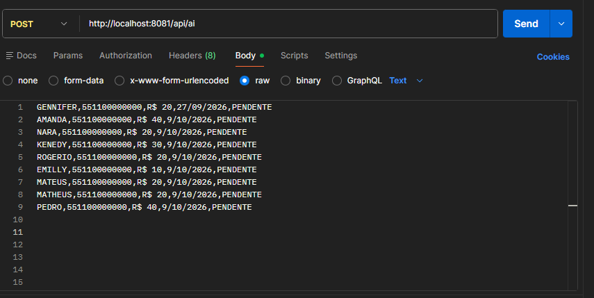

# BillFlow

## Pré-requisitos

- [Docker Desktop](https://www.docker.com/products/docker-desktop/)
- Uma IDE de sua preferência (recomendado: [IntelliJ IDEA](https://www.jetbrains.com/idea/))
- [Visual Studio Code](https://code.visualstudio.com/)
- [Postman](https://www.postman.com/downloads/)
- Uma chave de API criada no [Google AI Studio](https://aistudio.google.com/apikey), que deve ser colocada na variável `GEMINI_API_KEY`
  > O modelo de LLM fica a sua escolha (variável `GEMINI_MODEL`). Recomendo o `gemini-2.5-flash-lite`.

## Clonando o repositório

O primeiro passo é baixar o código do BillFlow para o seu computador. Para isso, abra um terminal na pasta onde deseja salvar o projeto e rode o comando abaixo (é necessário ter o [Git](https://git-scm.com/downloads) instalado):

```bash
git clone https://github.com/VitorMenezes2005/BillFlow.git
```

Depois, abra a pasta `BillFlow` criada pelo comando na sua IDE.

## Variáveis de ambiente

| Variável | Obrigatória | Exemplo | Função |
|---|---|---|---|
| `GEMINI_API_KEY` | sim | — | Chave da API do Google Gemini, usada pelo modelo de IA. |
| `GEMINI_MODEL` | sim | `gemini-2.5-flash-lite` | Nome do modelo do Gemini usado. |
| `SERVER_PORT` | sim | `8081` | Porta HTTP em que a aplicação sobe. |
| `WHATSAPP_API_KEY` | sim | — | Token da instância criada na Evolution API (gerado ao clicar em **Instance +**). |
| `WHATSAPP_INSTANCE` | sim | — | Nome da instância criada na Evolution API. |

## Instalando a Evolution API

O BillFlow envia as mensagens pelo WhatsApp usando a Evolution API. Para rodá-la com Docker, baixe o pacote [`setup/n8n-evo-docker-starter-main-guerra.rar`](setup/n8n-evo-docker-starter-main-guerra.rar) e siga os passos abaixo.

> O pacote é baseado no template [war721/N8N](https://github.com/war721/N8N/tree/main/n8n), criado por **Guerra721**.

1. Descompacte o arquivo no gerenciador de arquivos.
2. No VS Code, clique em **File → Open Folder** e abra a pasta descompactada.
3. Dentro do VS Code, crie uma cópia do arquivo `.env.example` e renomeie a cópia para `.env`.
4. Abra o `.env` e troque o valor da chave `AUTHENTICATION_API_KEY`.
   > Dica: use uma IA para gerar uma chave nova a partir da chave original que veio no `AUTHENTICATION_API_KEY`.
5. Aperte **Ctrl + S** para salvar o arquivo. Depois clique em **Terminal → New Terminal** e rode o comando:
   ```bash
   docker compose up -d
   ```
6. Espere o download de todas as imagens e abra o Docker Desktop.
7. No Docker Desktop, entre na aba **Containers** e clique na porta do `evolution_api`. Depois que a porta abrir, copie o endereço HTTP e cole no navegador em que a porta foi aberta (exemplo: `http://localhost:8080/manager`).
8. Por fim, realize o cadastro.

## Criar instância na Evolution API

Depois de realizar o cadastro na Evolution API e ter acesso ao restante do site, é necessário criar uma instância nova:

1. Clique em **Instance +** para criar a instância.
2. Copie o **token** gerado na criação da instância e use esse valor na variável de ambiente `WHATSAPP_API_KEY`.
3. Use o **nome da instância** criada na variável de ambiente `WHATSAPP_INSTANCE`.

> **Importante:** não esqueça de, depois de criar a instância, acessá-la e gerar o **QR Code** para se conectar com o WhatsApp Web. Sem essa conexão, as mensagens não são enviadas.

## Configurando o `.env`

O `.env` é o arquivo onde ficam os valores das variáveis de ambiente do BillFlow. Ele é lido automaticamente quando a aplicação sobe e não é enviado para o GitHub, então as suas chaves ficam só no seu computador.

> **Atenção:** este `.env` é o do **BillFlow**, na raiz do projeto clonado. Ele é diferente do `.env` da Evolution API, configurado na pasta descompactada.

1. Na raiz do projeto BillFlow, crie uma cópia do arquivo `.env.example` e renomeie a cópia para `.env`. Se preferir, use o terminal:
   ```bash
   cp .env.example .env
   ```
2. Abra o `.env` e preencha cada variável:

   | Variável | Onde conseguir o valor |
   |---|---|
   | `GEMINI_API_KEY` | A chave criada no Google AI Studio (veja os [Pré-requisitos](#pré-requisitos)). |
   | `GEMINI_MODEL` | O modelo do Gemini que você escolheu. Exemplo: `gemini-2.5-flash-lite`. |
   | `SERVER_PORT` | A porta do BillFlow. Use `8081`, porque a `8080` já é usada pela Evolution API. |
   | `WHATSAPP_API_KEY` | O token da instância (veja [Criar instância na Evolution API](#criar-instância-na-evolution-api)). |
   | `WHATSAPP_INSTANCE` | O nome da instância criada na Evolution API. |

3. Salve o arquivo. O resultado deve ficar parecido com este:
   ```
   GEMINI_API_KEY=sua-chave-do-google-ai-studio
   GEMINI_MODEL=gemini-2.5-flash-lite
   SERVER_PORT=8081
   WHATSAPP_API_KEY=token-da-sua-instancia
   WHATSAPP_INSTANCE=nome-da-sua-instancia
   ```

> Não use aspas nem espaços ao redor do `=`.

## Configurando o `AiService`

O prompt do assistente fica em `src/main/java/com/billflow/service/AiService.java`, na anotação `@SystemMessage`. A primeira linha tem dois campos que você precisa preencher com o contexto do seu uso:

```
Você é um membro de um [DIGITE SUA FINALIDADE] que gerencia [DIGITE SUA FINALIDADE].
```

| Campo | O que colocar | Exemplo |
|---|---|---|
| `[DIGITE SUA FINALIDADE]` | O setor ou a organização que o assistente representa. | `departamento financeiro` |
| `[DIGITE SUA FINALIDADE]` | O que esse setor gerencia, ou seja, de onde vêm as cobranças. | `a venda de produtos da loja` |

Com o exemplo preenchido, a linha fica assim:

```
Você é um membro de um departamento financeiro que gerencia a venda de produtos da loja.
```

O restante do prompt já define o comportamento e pode ser usado como está:
- **Detecção de pagamento pendente:** registros com `?`, `PENDENTE`, `NÃO PAGO` ou `AGUARDANDO PAGAMENTO` fazem o assistente usar a ferramenta *Enviar mensagem* para avisar o devedor pelo WhatsApp.
- **Dados faltando:** se faltar nome, data, valor ou número, o assistente pede só o que falta.
- **Fora do contexto:** perguntas sobre outros assuntos são recusadas.

Se quiser, você pode adaptar essas regras, por exemplo adicionando outros termos que indiquem pagamento pendente.

## Configuração de requisição via Postman

No Postman, crie uma requisição com o método **POST** e, no campo da rota HTTP, escreva:

```
http://localhost:8081/api/ai
```

Na aba **Headers**, clique em **Bulk Edit** e cole:

```
Content-Type: text/plain
User-Agent: PostmanRuntime/7.51.1
Accept: */*
Accept-Encoding: gzip, deflate, br
Connection: keep-alive
```

Os headers `Postman-Token`, `Content-Length` e `Host` são calculados pelo próprio Postman quando a requisição é enviada, então não precisam ser preenchidos.

Exemplo de como deve ficar:


## Como usar

1. Alimente uma planilha com as seguintes colunas:
   - **Nome**
   - **Número de telefone:** sem nenhum caractere especial, com o código do país + DDD (exemplo: `5511999999999`)
   - **Valor a ser pago**
   - **Data da compra**
   - **Status:** sempre marcado como `PENDENTE`. É com essa informação que a LLM entende para quais números enviar as mensagens de cobrança, caso você não queira filtrar quem está ou não pendente.
2. Baixe a planilha em `.csv`, copie o conteúdo desse arquivo e cole no campo **Body** da requisição no Postman (opção **raw**, tipo **Text**), conforme a imagem:

   ```
   NOME,5511999999999,R$ 20,27/09/2026,PENDENTE
   ```

   

3. Com o Docker em execução, o WhatsApp Web conectado via Evolution API e a aplicação Java Spring rodando, basta clicar em **Send** para o BillFlow entrar em ação.

> **Importante:** você precisa ter os contatos que serão cobrados salvos no seu WhatsApp.

Fique à vontade caso queira mexer na estrutura de envio das mensagens: ela fica na classe `ToolsServiceImpl` (`src/main/java/com/billflow/service/impl/ToolsServiceImpl.java`).

## Considerações Finais

> ⚠️ **Atenção:** use com moderação. A Evolution API **não é uma API oficial do WhatsApp**. Se o disparo de mensagens for excessivo, o WhatsApp pode suspender o número responsável pelos envios.

Caso queira entrar em contato: **vitorcarlos2005@outlook.com**

Obrigado por usar o BillFlow! Espero que ele ajude a simplificar as suas cobranças.
